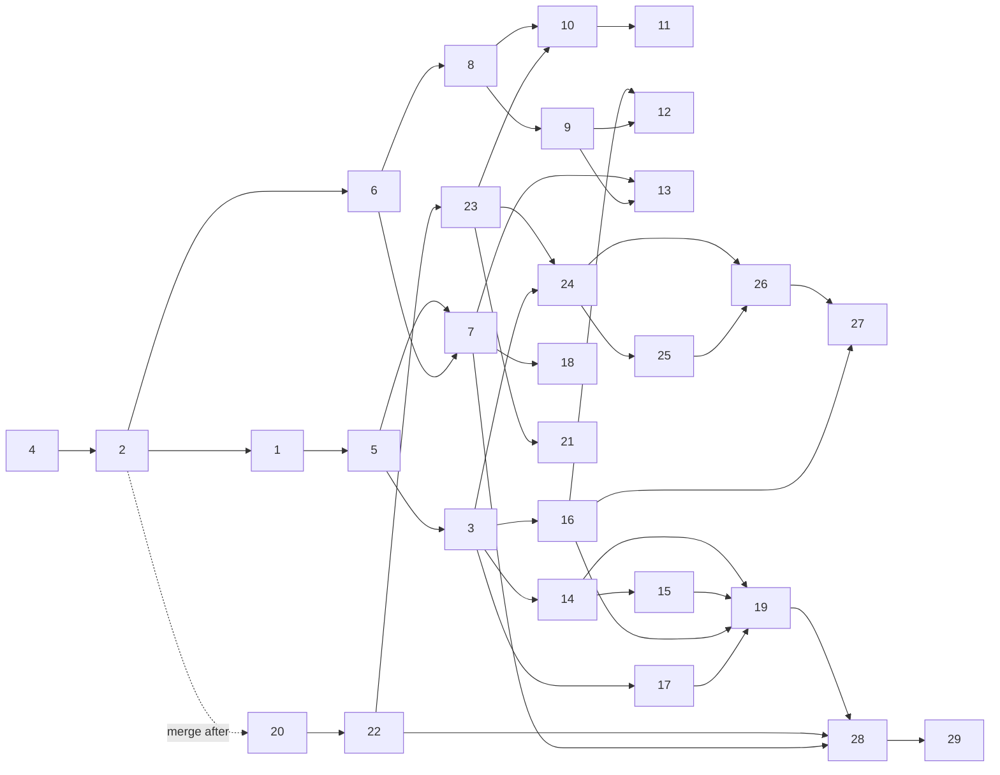

# Build order — feat/view-share (items #1–#29)

Read first: `docs/build/specs/00-cross-cutting.md`, the shared contract that every item spec defers to.

## Principles
1. **Foundations first.**
   - #4 (routes) and #2 (reading mode, App.vue split) reshape the shell every later FE item plugs into.
   - #6 (lazy editor) and #1 (theme, preview CSS extraction) follow immediately.
   - #20 (SQLite) starts at once, because #21–#27 depend on it.
2. **Cold seams before parallelism.** These items create the extension points in 00 §4, so later items add files instead
   of editing hot files:
   | Item | Seams it creates |
   |---|---|
   | #2 | `DocView`, `DocHeader` + per-control components, `useDocState`, `useGlobalShortcuts`, `AppToast`, `AppMenu` |
   | #1 | `src/styles/preview.css` |
   | #5 | `src/markdown/` |
   | #3 | `src/preview/` enhancers, `useFocusTrap` |
   | #8 | `src/editor/extensions.ts`, `EditorToolbar` |
   | #20 | `server/routes/*.cjs` |
3. **Lanes.** Items in one lane are sequential. Lanes in one wave run in parallel, each in its own worktree, because they
   touch mostly disjoint files. A file listed as **hot** below is edited by at most one lane per wave, except for the
   one-line registrations named in "Merge notes".
4. **Every wave ends green.** Merge the lanes in the listed merge order onto `feat/view-share`, then run
   `scripts/verify.sh` (typecheck, unit, build, e2e, server) on the merged head. The wave is done only when every step
   passes.
   - e2e runs serialise on the shared browser lock anyway, so lanes verify their own item with
     `E2E_FILES=<relevant files>` and the full suite runs once per wave.
   - After #6 lands, `npm run check:lazy-editor` joins the build step.
5. **Commits.**
   - One commit per item, titled `#NN <title>`. The body lists the ACs verified and any 00 § it implements.
   - Allowed extra commits:
     - a no-behaviour-change refactor commit immediately before its item: #1a extracts preview CSS; #2a decomposes
       App.vue/HeaderBar; #20a carves `server.cjs` into route modules;
     - the e2e selector updates that 00 §11 assigns to the item, in the same commit as the item.
   - No item is split across waves.

## Hot files (serialise edits)
| File | Edited by (in build order) | Seam that cools it |
|---|---|---|
| `src/App.vue` | #4, #2 (then router shell only: #26 route) | `DocView.vue` (#2) |
| `src/components/DocView.vue` (new, #2) | #6, #5, #3, #8 (origin), #7, #13, #10, #24, #25, #18, #19, #26, #28, #29 | keep each change to a slot or prop; merge order below |
| `HeaderBar.vue` → `DocHeader.vue` / `HeaderOverflowMenu.vue` | #2, #1, #5, #3, #25, #18, #19, #27, #29 | one component per control; one line each |
| `src/components/PreviewPane.vue` | #4 (bridge, links), #2 (selection gating), #1 (mermaid, bridge style), #5 (scroll model), #3 (`runEnhancers`), #7 (scroll API, scroll-ratio bridge), #18 (data attrs), #28 | enhancers (`src/preview/`), `preview.css` |
| `src/styles/preview.css` (new, #1) | #1, #5, #14, #16, #17, #18 (em pass), #12, #28, #29 | CSS conflicts only; #18's em pass must not overlap #12 → #18 merges first in W4 |
| `src/composables/useMarkdown.ts` | #5, #3, #14, #16, #12, #28, #29 | plugins in `src/markdown/`, one registration line each |
| `src/components/EditorPane.vue` | #6 (none), #8, #7 (scroll API), #13 (column style), #11 (`formatTable` expose) | `src/editor/extensions.ts` |
| `src/composables/useSync.ts` | #2 (mode), #8 (remote origin), #23 (token header) | merge #8 before #23 |
| `server/server.cjs` | #2 (mode), #20 (restructure), then one table line per server item | `server/routes/*.cjs` (#20) |
| `server/mcp-server.js` + `mcp-server-http.js` | #4, #2, #22, #23, #21, #24, #25, #27, #28 | one handler per tool; W3 has a single MCP lane (D) |

## Dependency DAG (hard = must be merged first)
| # | Item | Hard deps | Soft / later interaction |
|---|---|---|---|
| 4 | Path routes | — | #3 swaps slugger later; #22 server side |
| 2 | Reading mode + shell split | 4 | #23 replaces the capability source |
| 6 | Lazy editor | 2, 4 | #7 #8–#13 live in the chunk |
| 1 | Locus theme + preview.css | 2 | #5 phone header, #14/#16/#17 tokens |
| 20 | SQLite + FTS + `/library/docs` | 2 (merge after; `mode`) | blocks #21–#27 |
| 5 | Mobile, print, docTitle, line offsets | 2, 1 | #3 TOC slot; #18 width |
| 3 | TOC + heading ids + enhancers | 5, 4, 2 | #12 #16 #17 #24 #28 use ids |
| 8 | Undo/redo + EditorToolbar | 6 | #9 #10 #11 #12 #13 |
| 9 | Markdown shortcuts | 8 | #13 overlay row |
| 22 | OG meta route + cover | 20, 4 | #28 human-view description |
| 23 | View/edit links + tokens | 22, 20, 2, 4 | #10 upload token, #21, #25, #26 |
| 14 | Code copy | 1, 5, 3 | #15 feedback contract, #19 strip |
| 16 | Callouts + RAG | 1, 3, 5 | #12, #27 seeds |
| 17 | Collapsible | 3, 5 | #19 expands |
| 15 | Zoom viewer | 14, 3, 1 | #29 key isolation |
| 7 | Split view | 6, 5, 2, 4 | #13, #18 |
| 13 | Focus mode | 7, 8, 9 | — |
| 10 | Paste image | 8, 23, 2 | #11 paste order |
| 11 | Table paste | 10, 8 | #12 |
| 21 | Upsert by key | 20, 22, 23 | — |
| 24 | Reactions (+ `useReader`) | 20, 23, 3 | #25, #26 |
| 25 | Views + readers | 24, 23 | #26 counts |
| 18 | Font size + width | 1, 5, 7, 2 | — |
| 19 | Downloads | 1, 4, 5, 14, 15, 16, 17 | #28 view-aware `.md` |
| 12 | Slash menu | 8, 9, 16, 3 | — |
| 26 | Library + multi-file | 20, 4, 2, 23, 24, 25 | #27 |
| 27 | Templates | 26, 16, 23 | — |
| 28 | Agent view | 3, 4, 7, 19, 22 | #29 |
| 29 | Slides | 28, 14, 15, 16, 17, 1, 5 | — |

## Wave plan
### Wave 1 — Shell and storage
| Lane | Items | Main files |
|---|---|---|
| 1A (FE shell) | #4 → #2 → #6 → #1 | App.vue, new `useRouter.ts`, `useShare`/`usePersistence`, `DashboardView`, PreviewPane bridge, `vite.config.ts` (404.html), MCP/CLI URLs (#4) · `DocView`, `DocHeader`, `HeaderOverflowMenu`, `ViewToggle`, `AppToast`, `AppMenu`, `useDocState`, `useGlobalShortcuts`, server `mode`, MCP `mode` (#2) · async EditorPane, prefetch, `check:lazy-editor` (#6) · `useTheme`, `ThemeSwitcher`, `style.css`, `preview.css` extraction, mermaid theme (#1) |
| 1B (server) | #20 | `server/db.cjs`, `server/routes/*`, migrate script, `server/test*.mjs`, fixtures |

- **Merge order:** #4, #2, #20, #6, #1.
- **Note:** #20 is developed in parallel from the start, but it rebases onto #2 before merging so it stores and
  migrates `mode`. The AC-20.3 golden comparison is against the server at #2.
- **Green gate:** full verify. Includes the 00 §11 e2e updates for #1, #2 and #4 (Preview→Read, overflow items,
  `mode:"review"` sessions, theme cycle).

### Wave 2 — Reader core, editor core, sharing
| Lane | Items | Main files |
|---|---|---|
| 2A (reader) | #5 → #3 | `style.css`/`preview.css` (scroll model, print, breakpoints), `DocHeader` tablet/phone + `doc-meta-row`, `src/markdown/` (tableScroll, autolink, plainText, front-matter offset), `useDocTitle` (#5) · `src/markdown/headingIds.ts`, `TocPanel`, `useActiveHeading`, `useFocusTrap`, `src/preview/enhancers.ts` + `headingAnchors.ts` (#3) |
| 2B (editor) | #8 → #9 | `EditorPane`, `src/editor/extensions.ts` + `history.ts`, `EditorToolbar`, `useExternalChange`, `useSync` (remote origin) (#8) · `src/editor/markdownCommands.ts`, `ShortcutsOverlay`, `?` in `useGlobalShortcuts` (#9) |
| 2C (server sharing) | #22 → #23 | `server/routes/meta.cjs`, `cover.cjs`, fonts, `@resvg/resvg-js` (#22) · `server/routes/edit-tokens.cjs` + write guard, MCP token store, CLI, `useEditToken`, `ShareModal`, `useShare`, `useSync` token header, `useDocState` capability (#23) |

- **Merge order:** #8, #5, #22, #9, #3, #23. #8 goes before #23 because both edit `useSync`.
- **Green gate:** full verify. #5 brings document scroll and the 50em column, so re-run the coordinate-based e2e
  (00 §11). Once #23 lands, viewer ACs from #2/#4/#6 are re-run against a protected doc opened without a token
  (00 §1.2).

### Wave 3 — Reader rendering, split/focus, editor input, social backend
| Lane | Items | Main files |
|---|---|---|
| 3A (reader rendering) | #14 → #16 → #17 → #15 | `src/markdown/codeBlock.ts`, `src/preview/codeCopy.ts` · `src/markdown/alerts.ts` + `rag.ts` · `src/preview/folding.ts`, `useFolding`, TocPanel buttons · `ZoomViewer`, `useZoomPan`, `src/preview/zoom.ts`. `preview.css` for each |
| 3B (editor layout) | #7 → #13 | `SplitView`, `useScrollSync`, PreviewPane scroll API + `scroll-ratio` bridge, `EditorPane` scroll API, `ViewToggle` split, `DocView` (#7) · `FocusControls`, `EditorToolbar` button, `useGlobalShortcuts`, `DocView` chrome hiding, overlay row (#13) |
| 3C (editor input) | #10 → #11 | `src/editor/imagePaste.ts`, share-required dialog in `DocView`, upload helper, files-route `assets/` validation (#10) · `src/editor/tablePaste.ts`, `formatTable` expose, overlay row (#11) |
| 3D (social backend) | #21 → #24 → #25 | `server/routes/by-key.cjs`, `upsert_session`, CLI `publish`, `RevisionsModal` note (#21) · `server/routes/reactions.cjs`, `useReader`, `useReactions`, `ReactionBar`, `src/preview/sectionReactions.ts` (#24) · `server/routes/views.cjs`, `useViews`, `ViewStats`, `ReadersPanel` (#25). MCP tools for all three |

- **Merge order:** #7, #14, #21, #10, #16, #13, #24, #11, #17, #25, #15.
  - #7 first: it is the only W3 item editing `PreviewPane.vue` and `EditorPane.vue` core.
  - #13 after #7 and #9. #11 after #10. #15 last in 3A.
  - `DocView` slot order: #7, #13, #10, #24, #25.
- **Merge notes:**
  - One-line conflicts are expected in `useMarkdown.ts` (3A plugin registrations), `src/editor/extensions.ts` (3C) and
    the `shortcuts-overlay` row data (#11, #13). Resolve by keeping both lines.
- **Green gate:** full verify, plus the deferred ACs of #8: AC-08.5 table half via #11, AC-08.11 Split half via #7.

### Wave 4 — Reader controls, downloads, slash menu, library
| Lane | Items | Main files |
|---|---|---|
| 4A (reader controls) | #18 → #19 | `useReaderPrefs`, `ReaderSettings`, `preview.css` px→em + width, PreviewPane data attributes (#18) · `useDownload`, `DownloadMenu`, overflow Download group, `preview.css?inline` (#19) |
| 4B (slash) | #12 | `src/editor/slashMenu.ts`, `SlashMenu.vue`, `src/markdown/inlineToc.ts`, `.inline-toc` styles |
| 4C (library) | #26 → #27 | `LibraryView` + parts, `useLibrary`, `useRecent`, `FileTabs`, `DocBreadcrumb`, `server/routes/library.cjs`, file FTS rows, App `/library` route, `DashboardView` removed (#26) · `server/routes/templates.cjs`, `server/templates/`, `template-vars.cjs`, `TemplatePicker`, `SaveTemplateDialog`, overflow item, MCP tools (#27) |

- **Merge order:** #18, #26, #12, #19, #27. #18's em pass lands before #12's `.inline-toc` CSS and #19's CSS inlining.
- **Green gate:** full verify. Includes the dashboard e2e rewrite in `qa-gate-features` (00 §11) and the deferred
  AC-08.5 `/table` half via #12.

### Wave 5 — Agent view and slides
| Lane | Items | Main files |
|---|---|---|
| 5A | #28 → #29 | `shared/agentSections.mjs`, `src/markdown/agentSections.ts`, `useDocTitle`/`useDownload` view-awareness, `server/routes/raw.cjs` (`/d/:x.md`, `/llms.txt`), `meta.cjs` human-view title and description, MCP `get_session` view (#28) · `SlidesView`, `useSlides`, slide split plugin, `--slide-title-*` tokens, slides print scope (#29) |

- **Green gate:** full verify, then Phase 5 (persona QA, final review, PR).

## Summary
| Wave | Lanes | Items (merge order) |
|---|---|---|
| W1 | 2 | 4, 2, 20, 6, 1 |
| W2 | 3 | 8, 5, 22, 9, 3, 23 |
| W3 | 4 | 7, 14, 21, 10, 16, 13, 24, 11, 17, 25, 15 |
| W4 | 3 | 18, 26, 12, 19, 27 |
| W5 | 1 | 28, 29 |

Longest chain (by lane order): #4 → #2 → #6 → #1 → #5 → #3 → #14 → #16 → #17 → #15 → #19 → #28 → #29. Lane 3A and #19 are the
schedule risk: if 3A slips, start #18 (needs only #7) while 3A finishes, and hold #19 until #15 is merged.
